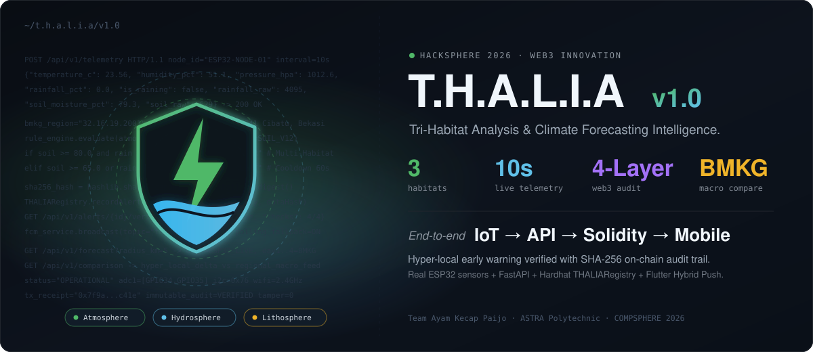
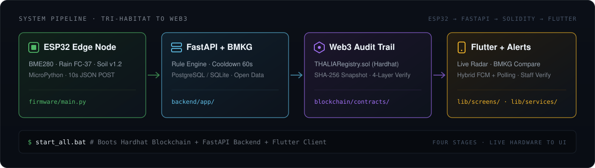
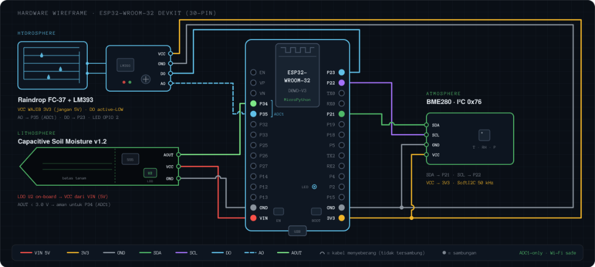
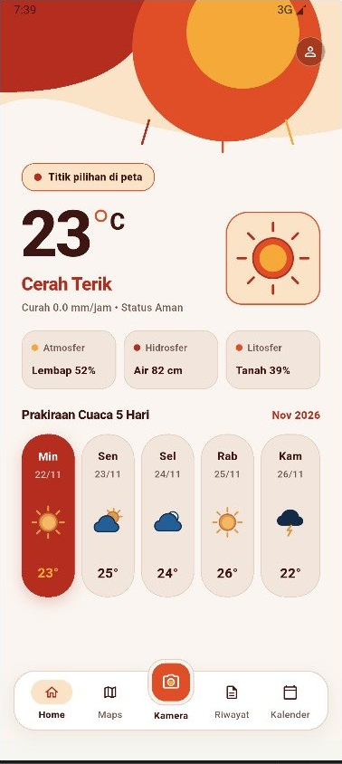

<div align="center">

<br/>


# T.H.A.L.I.A

*Tri-Habitat Analysis & Climate Forecasting Intelligence.*

<p>
  <a href="#architecture"></a>
  <a href="#iot-hardware-node-esp32"></a>
  <a href="#core-api--web3-audit"></a>
  <a href="#core-api--web3-audit"></a>
  <a href="#quick-start"></a>
  <a href="#tri-habitat-classification-rules"></a>
</p>

<br/>



<br/>

**Hyper-local multi-habitat disaster early warning with an immutable Web3 audit trail.**<br/>
**3 Habitats** · **10s Live Telemetry** · **4-Layer Tamper Verification** · **Hybrid FCM + Polling Alerts**

<p>
  <sub>
    Built in 24 hours for <strong>Hacksphere 2026 (COMPSPHERE)</strong> · President University, Cikarang · Team <strong>Ayam Kecap Paijo</strong> (ASTRA Polytechnic)
  </sub>
</p>

<p>
  <a href="#live-telemetry-in-action">Live Telemetry</a> ·
  <a href="#architecture">Architecture</a> ·
  <a href="#tri-habitat-classification-rules">Classification Rules</a> ·
  <a href="#iot-hardware-node-esp32">Hardware Wiring</a> ·
  <a href="#app-preview">App Preview</a> ·
  <a href="#core-api--web3-audit">API &amp; Web3</a> ·
  <a href="#quick-start">Quick Start</a> ·
  <a href="#team">Team</a>
</p>

</div>

---

## Live Telemetry in Action

Real JSON telemetry captured directly from **`ESP32-NODE-01`** (Cibatu, Cikarang Selatan) posting to the FastAPI ingestion endpoint every 10 seconds, followed by an on-chain integrity check:

```text
[1/3] Menyiapkan pin & sensor...
 ✓ BME280 siap di 0x76
[2/3] Menghubungkan Wi-Fi... ✅ IP: 10.186.123.106
[3/3] T.H.A.L.I.A berjalan!

[TELEMETRY] {"node_id": "ESP32-NODE-01", "location_name": "Cibatu, Cikarang Selatan, Bekasi",
             "latitude": -6.3378, "longitude": 107.1541,
             "temperature_c": 23.50, "humidity_pct": 51.2, "pressure_hpa": 1012.6,
             "rainfall_pct": 0.0, "is_raining": false, "rainfall_raw": 4095,
             "soil_moisture_pct": 79.3, "soil_raw": 629}
 -> API 200 OK

$ curl -s http://127.0.0.1:8000/api/v1/alerts/1/verify
 -> {"verified": true, "tampered": false, "checks": {
       "snapshot_hash_matches_stored": true,
       "onchain_hash_matches_stored": true,
       "telemetry_row_matches_snapshot": true,
       "alert_fields_match_snapshot": true
     }}
```

> → Full guides: [Backend API Documentation](API_DOCUMENTATION.md) · [ESP32 Firmware Guide](firmware/README.md) · [Flutter API Integration](API.md)

---

## Architecture

<p align="center">
  
</p>

T.H.A.L.I.A bridges **hyper-local physical telemetry** with **macro-regional BMKG forecasts** and locks every critical disaster alert hash onto an EVM smart contract (`THALIARegistry.sol`) so early warnings remain verifiable and tamper-evident.

| Layer | Technology | Repository Path / Branch | Core Responsibility |
| :--- | :--- | :--- | :--- |
| **IoT Edge Node** | ESP32 (`ESP-WROOM-32`), MicroPython `v1.29.0` | [`firmware/`](firmware/README.md) · `feat/iot-firmware` | Reads BME280, FC-37 Raindrop, and Capacitive Soil v1.2 every 10s; applies 15-sample ADC averaging + 3-window soil smoothing |
| **Core Backend** | Python, FastAPI, SQLAlchemy (PostgreSQL / SQLite) | `backend/app/` · `Backend` | Ingests telemetry, runs Tri-Habitat Rule Engine (60s anti-spam cooldown), compares with BMKG Open Data (`32.16.19.2001`), serves Auth/Reports/Forecast |
| **Web3 Audit Trail** | Solidity, Hardhat, Web3.py (`THALIARegistry.sol`) | `blockchain/` · `Backend` | Anchors canonical SHA-256 alert snapshots on-chain; exposes 4-layer cross-table tamper verification |
| **Mobile & Web UI** | Flutter, OpenStreetMap, Hybrid FCM + Polling | `lib/` · `UI` | Live radar map, 5-day forecast (Day 0 live ESP32), BMKG delta view, citizen photo reports + staff verification, offline-first cache |

---

## Tri-Habitat Classification Rules

Thresholds are centrally managed in `backend/app/core/config.py` and evaluated by `DisasterRuleEngine` on every incoming packet:

| Habitat | Sensor Hardware | Metric | `ALERT` (Waspada) | `DANGER` (Bahaya) |
| :--- | :--- | :--- | :--- | :--- |
| **Atmosphere** | BME280 (`I2C 0x76`) | Pressure & Humidity | Pressure `< 1005.0 hPa` + Humidity `>= 85%` (or drop `>= 4.0 hPa`) | Combined with severe hydro/litho trigger |
| **Hydrosphere** | Raindrop FC-37 (`AO` + `DO`) | `rainfall_pct` (`0–100%`) | `>= 30.0%` | `>= 75.0%` |
| **Lithosphere** | Capacitive Soil Moisture v1.2 | `soil_moisture_pct` (`0–100%`) | `>= 65.0%` | `>= 85.0%` *(extreme)* |
| **Multi-Habitat** | Soil v1.2 + FC-37 | Cross-habitat correlation | — | `soil >= 80.0%` **AND** `rain >= 30.0%` |

---

## IoT Hardware Node (ESP32)

<p align="center">
  
</p>

> **Voltage Safety Notice:**
> - **BME280** and **Raindrop FC-37** **MUST use `3V3`** (never `5V`) so analog `AO` stays within the ESP32 3.3V ADC limit.
> - **Capacitive Soil Moisture v1.2** (board with on-board 3.3V LDO `U2`) uses **`VIN` (5V)** so its oscillator operates cleanly while keeping `AOUT < 3.0V`.
> - All analog sensors are wired strictly to **ADC1** (`GPIO 34`, `GPIO 35`) to avoid Wi-Fi 2.4 GHz radio conflicts.

| Module | Habitat | Power | ESP32 Pins | Calibration / Notes |
| :--- | :--- | :--- | :--- | :--- |
| **BME280** | Atmosphere | `3V3` / `GND` | `P21` (`SDA`), `P22` (`SCL`) | SoftI2C `50 kHz`, address `0x76`, Forced Mode + auto-reconnect |
| **Raindrop FC-37** | Hydrosphere | `3V3` / `GND` | `P23` (`DO`), `P35` (`AO` / ADC1) | `RAIN_DRY = 4095`, `RAIN_WET = 1200`; `DO` drives on-board LED (`GPIO 2`) |
| **Capacitive Soil v1.2** | Lithosphere | `VIN` (5V) / `GND` | `P34` (`AOUT` / ADC1) | `SOIL_DRY = 2480`, `SOIL_WET = 650`; 15-sample ADC + 3-window MA |

---

## App Preview

<div align="center">

| Live Dashboard — Clear / Safe State |
| :---: |
|  |
| <sub>Real-time Tri-Habitat telemetry (<code>23°C</code> · <code>0.0 mm/h</code> · <code>Humidity 52%</code> · <code>Soil 39%</code>) + 5-day forecast</sub> |

</div>

<!--
Additional screens (uncomment as screenshots are added to docs/assets/screenshots/):

| Cloudy / Alert State | Hyper-Local vs BMKG | Web3 On-Chain Verification |
| :---: | :---: | :---: |
|  |  |  |
-->

---

## Core API & Web3 Audit

| Method | Endpoint | Purpose |
| :--- | :--- | :--- |
| `POST` | `/api/v1/telemetry` | Ingest live JSON from ESP32, run Rule Engine, anchor alert hash on-chain, trigger FCM |
| `GET` | `/api/v1/telemetry/latest` | Fetch latest multi-habitat readings from the edge node |
| `GET` | `/api/v1/forecast` | 5-day forecast (Day 0 fused with live ESP32 telemetry + BMKG Open Data) |
| `GET` | `/api/v1/comparison` | Compare hyper-local ESP32 readings against regional BMKG data |
| `GET` | `/api/v1/alerts` | List disaster alert history with blockchain transaction hash |
| `GET` | `/api/v1/alerts/{id}/verify` | 4-layer anti-tamper verification (snapshot, DB row, alert fields, and `THALIARegistry.sol`) |
| `POST` | `/api/v1/reports` & `/{id}/verify` | Multipart citizen photo report submission & staff verification workflow |
| `POST` | `/api/v1/auth/login` & `/register` | PBKDF2 authentication (seeded demo roles: `admin`, `staff`, `warga`) |

---

## Quick Start

### 1. Backend + Local Blockchain (Hardhat + FastAPI)

```powershell
# All-in-one launcher (Windows)
.\start_all.bat

# Or start manually
cd blockchain && npx hardhat node
cd blockchain && npx hardhat run scripts/deploy.js --network localhost
cd backend && uvicorn app.main:app --host 0.0.0.0 --port 8000 --reload
```

### 2. Flutter Mobile / Web Client

```powershell
flutter pub get

# Connect to live FastAPI server (replace IP with backend host)
flutter run --dart-define=THALIA_USE_MOCK=false --dart-define=THALIA_API_URL=http://127.0.0.1:8000
```

### 3. ESP32 Edge Node (MicroPython / Thonny IDE)

```text
1. Copy firmware/secrets.example.py -> secrets.py and fill in your 2.4 GHz Wi-Fi & FastAPI IP.
2. Upload both secrets.py and firmware/main.py to the ESP32 flash via Thonny IDE.
3. Power via USB or 5V 2A Power Bank — telemetry begins streaming every 10 seconds automatically.
```

---

## Team

**Team Ayam Kecap Paijo** — *ASTRA Polytechnic* (National Category, Hacksphere 2026)

| Member | Focus Area |
| :--- | :--- |
| **I Putu Yoga Dhananjaya** | Backend Architecture, FastAPI, BMKG Integration & Web3 Smart Contract |
| **Rafie Maulana Putra .R** | IoT Hardware Engineering, ESP32 MicroPython Firmware & Sensor Calibration |
| **Muhamad Haikal Eka Putra** | Flutter UI/UX Design, Mobile App & Frontend Integration |

---

<div align="center">
  <sub>Built with live sensors, real commits, and zero fake mockups at <strong>Hacksphere 2026 · COMPSPHERE</strong>.</sub>
</div>
